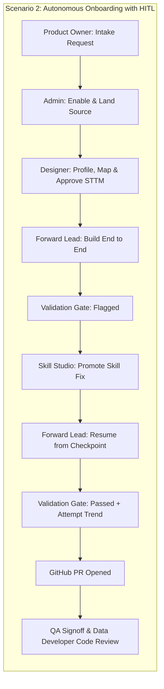

# Plan: End-to-End Persona Flows for Scenario 1 & Scenario 2

## 1. Context

Tracing both live demo scenarios across personas against `DEV_AI_PLATFORM.CORE` and the `/os` UI surfaced six root causes that prevent seamless end-to-end execution when switching personas:

1. **Missing `source_datatype` & `PROFILE_REGISTRY` fallback during dbt generation and standards review (`COMPANY_INDUSTRY` false-positive failure)**:
   - When `Build end to end` ran on `COMPANY_INDUSTRY` (`f620cd9c-75d7-4e18-9728-088cdf606947`), it generated Soda checks, approved them via `CORE.AUTOPILOT_APPROVE_DQ`, generated 15 dbt files, and ran validation, which stopped at `VALIDATION_FAILED` (`91.7%, 1 error` on `STANDARDS_TYPES`).
   - Why:
     - [gdp-agent-platform/services/dbt/inputs.py](gdp-agent-platform/services/dbt/inputs.py) queries `INFORMATION_SCHEMA.COLUMNS` on the landing database (`DEV_GDP_BRONZE_DB`), which fails inside the owner's-rights `CORE.GENERATE_DBT` procedure and sets `columns = {}` without falling back to `CORE.PROFILE_REGISTRY` (which already has all 29 profiled source columns and types on the run).
     - [gdp-agent-platform/services/dbt/procedures.py](gdp-agent-platform/services/dbt/procedures.py) omits `"source_datatype": r.get("SOURCE_DATATYPE")` when loading `CORE.STTM_LINE`, and [gdp-agent-platform/services/dbt/onboard.py](gdp-agent-platform/services/dbt/onboard.py) does not fall back to `c.get("source_datatype")`.
     - [gdp-agent-platform/services/validation/procedures.py](gdp-agent-platform/services/validation/procedures.py) omits `source_column` in `_sttm_lines`, and [gdp-agent-platform/services/validation/standards.py](gdp-agent-platform/services/validation/standards.py) `mapping_context` omits `source_column` and `source_datatype`, causing `CODE-STANDARDS-REVIEW` to confuse `SILVER_ZOOMINFO_COMPANY.GDP_IS_ACTIVE` (`BOOLEAN`) with the target audit column `GDP_IS_ACTIVE` (`TEXT`).

2. **"Resume from checkpoint" missing in Autopilot and UI for Scenario 2 (`VALIDATION_FAILED` -> Update skill -> Resume from checkpoint -> Validation passes -> PR)**:
   - In [gdp-agent-platform/services/workflow/autopilot.py](gdp-agent-platform/services/workflow/autopilot.py), `next_action("VALIDATION_FAILED", facts)` always returns `BLOCKED`. While it must stop when `validate` fails mid-run, starting Autopilot on a run that is *already* in `VALIDATION_FAILED` (resuming from checkpoint after updating/promoting a skill) needs to regenerate dbt from the approved STTM + DQ checkpoint (`generate_dbt`), re-validate (`validate`), and open the PR (`publish_pr`).
   - In [gdp-agent-platform/apps/web/app/os/review/page.tsx](gdp-agent-platform/apps/web/app/os/review/page.tsx), [gdp-agent-platform/apps/web/app/os/skills/page.tsx](gdp-agent-platform/apps/web/app/os/skills/page.tsx), and [gdp-agent-platform/apps/web/app/os/build/page.tsx](gdp-agent-platform/apps/web/app/os/build/page.tsx), there is no `Resume from checkpoint` button (`<BuildEndToEnd label="Resume from checkpoint" />`), and links from `/os/review` to `/os/skills` drop `&run=${run.run_id}`.

3. **Multi-table `VALIDATION_FAILED` wait ordering in `services/onboarding/requests.py`**:
   - In [gdp-agent-platform/services/onboarding/requests.py](gdp-agent-platform/services/onboarding/requests.py), `worst` sorts child table runs by `(stage_index(p["stage"]), p["status"] != "ATTENTION")`, but `waits` sorted only by `stage_index(p["stage"])`, putting `STTM_APPROVED` sibling waits ahead of a `VALIDATION_FAILED` (`ATTENTION`) child table run's wait.

4. **Branch name collisions across multi-table child runs**:
   - In [gdp-agent-platform/services/dbt/procedures.py](gdp-agent-platform/services/dbt/procedures.py), `branch_slug` truncates `run_name` at 40 characters (`(run_name or run_id)[:40]`), cutting off `: COMPANY_INDUSTRY` / `: COMPANY_RELATIONSHIP` and giving every child table run the same Git branch name.

5. **Parent-to-child table run resolution and switcher on `/os/review`, `/os/release`, and `DemoPaths`**:
   - [gdp-agent-platform/apps/web/app/os/review/page.tsx](gdp-agent-platform/apps/web/app/os/review/page.tsx), [gdp-agent-platform/apps/web/app/os/release/page.tsx](gdp-agent-platform/apps/web/app/os/release/page.tsx), and [gdp-agent-platform/apps/web/components/os/demo-paths.tsx](gdp-agent-platform/apps/web/components/os/demo-paths.tsx) did not resolve multi-table parent run IDs to their active child table run or display the `Target tables in this workflow` switcher bar.

6. **Persona switching in header (`OsShell`)**:
   - In [gdp-agent-platform/apps/web/components/os/shell.tsx](gdp-agent-platform/apps/web/components/os/shell.tsx), `choose(id)` unconditionally navigates to `persona.home`, kicking the presenter off `/os` (Home) or dropping `?run=...` / `?request=...` when switching personas on a shared screen during a live demo.

## 2. Implementation Steps

1. **Propagate source data types in dbt generation & standards review**:
   - In [gdp-agent-platform/services/dbt/inputs.py](gdp-agent-platform/services/dbt/inputs.py), fall back to `CORE.PROFILE_REGISTRY` when `INFORMATION_SCHEMA.COLUMNS` returns no columns for a landed table, and include `source_datatype` in `mappings/sttm.json`.
   - In [gdp-agent-platform/services/dbt/procedures.py](gdp-agent-platform/services/dbt/procedures.py), include `"source_datatype": r.get("SOURCE_DATATYPE")` in `lines` and increase `branch_slug` truncation from `40` to `72` characters so child table runs get distinct Git branches.
   - In [gdp-agent-platform/services/dbt/onboard.py](gdp-agent-platform/services/dbt/onboard.py), fall back `stype` to `str(c.get("source_datatype") or "")`.
   - In [gdp-agent-platform/services/validation/procedures.py](gdp-agent-platform/services/validation/procedures.py) and [gdp-agent-platform/services/validation/standards.py](gdp-agent-platform/services/validation/standards.py), include `source_column` and `source_datatype` in `mapping_context`.

2. **Enable "Resume from checkpoint" in Autopilot and Onboarding Request waits**:
   - In [gdp-agent-platform/services/workflow/autopilot.py](gdp-agent-platform/services/workflow/autopilot.py), when `state == "VALIDATION_FAILED"` and `facts.get("resume")` is truthy, return `_act("generate_dbt")` (autonomous) or `_act("validate")`.
   - In [gdp-agent-platform/apps/api/app/autopilot_api.py](gdp-agent-platform/apps/api/app/autopilot_api.py), in `drive()`, set `facts["resume"] = True` when `not done and state == "VALIDATION_FAILED"` so starting Autopilot on a `VALIDATION_FAILED` run regenerates dbt with the updated skill, re-validates, and opens the PR, while still stopping if validation fails mid-build.
   - In [gdp-agent-platform/services/onboarding/requests.py](gdp-agent-platform/services/onboarding/requests.py), sort `waits` by `(stage_index(p["stage"]), p["status"] != "ATTENTION")` so `VALIDATION_FAILED` waits appear first on multi-table requests.

3. **Add "Resume from checkpoint" UI and multi-table switcher across `/os/review`, `/os/skills`, `/os/build`, `/os/release`, and `DemoPaths`**:
   - In [gdp-agent-platform/apps/web/app/os/review/page.tsx](gdp-agent-platform/apps/web/app/os/review/page.tsx): resolve parent runs to child table runs, render the `Target tables in this workflow` switcher bar, pass `&run=${run.run_id}` to Skill Studio links, and render `<BuildEndToEnd runId={run.run_id} label="Resume from checkpoint" />` when validation is flagged.
   - In [gdp-agent-platform/apps/web/app/os/skills/page.tsx](gdp-agent-platform/apps/web/app/os/skills/page.tsx): accept `searchParams.run`, highlight the run in `Controlled recovery`, and render `<BuildEndToEnd runId={...} label="Resume from checkpoint" />` plus direct links back to Validation Gate (`/os/review?run=...`) and Build Workbench (`/os/build?view=selected&run=...`).
   - In [gdp-agent-platform/apps/web/app/os/build/page.tsx](gdp-agent-platform/apps/web/app/os/build/page.tsx): include `<BuildEndToEnd runId={runId} label="Resume from checkpoint" />` in the header actions when `validationFailed`.
   - In [gdp-agent-platform/apps/web/app/os/release/page.tsx](gdp-agent-platform/apps/web/app/os/release/page.tsx) and [gdp-agent-platform/apps/web/components/os/demo-paths.tsx](gdp-agent-platform/apps/web/components/os/demo-paths.tsx): resolve parent runs to child table runs, filter `leafRuns`, and show the multi-table switcher bar on Release.

4. **Preserve current page & query parameters when switching personas in `OsShell`**:
   - In [gdp-agent-platform/apps/web/components/os/shell.tsx](gdp-agent-platform/apps/web/components/os/shell.tsx) (and [gdp-agent-platform/apps/web/app/layout.tsx](gdp-agent-platform/apps/web/app/layout.tsx)), pass each persona's accessible screen keys so `choose(id)` stays on the current URL + query string (`router.refresh()`) whenever the new persona can view the current screen, and only navigates to `persona.home` when leaving a screen restricted to the previous persona.

5. **Deploy to Snowflake `dev` and run end-to-end persona verification**:
   - Run unit tests (`pytest`) and TypeScript check (`tsc --noEmit`).
   - Deploy updated Python procedures (`CORE.GENERATE_DBT`, `CORE.VALIDATE_DBT`) to Snowflake `dev` via `python infrastructure/deploy.py --env dev`.
   - Execute an end-to-end verification of Scenario 1 and Scenario 2 switching personas (`product_owner`, `admin`, `designer`, `forward_lead`, `qa`, `developer`).

## 3. Verification

- Run `pytest tests/unit/test_autopilot.py tests/unit/test_onboarding_requests.py tests/unit/test_code_standards.py tests/unit/test_dbt_onboard.py`
- Run `npx tsc --noEmit` in `apps/web`
- Deploy updated stored procedures to `DEV_AI_PLATFORM.CORE` and test resuming `COMPANY_INDUSTRY` (`f620cd9c-75d7-4e18-9728-088cdf606947`) from checkpoint (`VALIDATION_FAILED` -> `Resume from checkpoint` -> `VALIDATION_PASSED` -> `PR` -> `DBT_REVIEW`) and building a ready run (`COMPANY_RELATIONSHIP` or `COMPANY_SEGMENT`) as `forward_lead` -> `qa` -> `developer`.

## 4. Critical Files

- [gdp-agent-platform/services/dbt/inputs.py](gdp-agent-platform/services/dbt/inputs.py) - Fallback to `CORE.PROFILE_REGISTRY` for source column types and include `source_datatype`
- [gdp-agent-platform/services/validation/standards.py](gdp-agent-platform/services/validation/standards.py) - Include source column and datatype in `mapping_context` for `CODE-STANDARDS-REVIEW`
- [gdp-agent-platform/services/workflow/autopilot.py](gdp-agent-platform/services/workflow/autopilot.py) - Support `resume` from checkpoint on `VALIDATION_FAILED` runs
- [gdp-agent-platform/apps/web/app/os/review/page.tsx](gdp-agent-platform/apps/web/app/os/review/page.tsx) - Multi-table child resolution, table switcher, and `Resume from checkpoint` action
- [gdp-agent-platform/apps/web/app/os/skills/page.tsx](gdp-agent-platform/apps/web/app/os/skills/page.tsx) - `Resume from checkpoint` in `Controlled recovery` and run context preservation
- [gdp-agent-platform/apps/web/components/os/shell.tsx](gdp-agent-platform/apps/web/components/os/shell.tsx) - Keep current page and query params when switching personas if accessible
