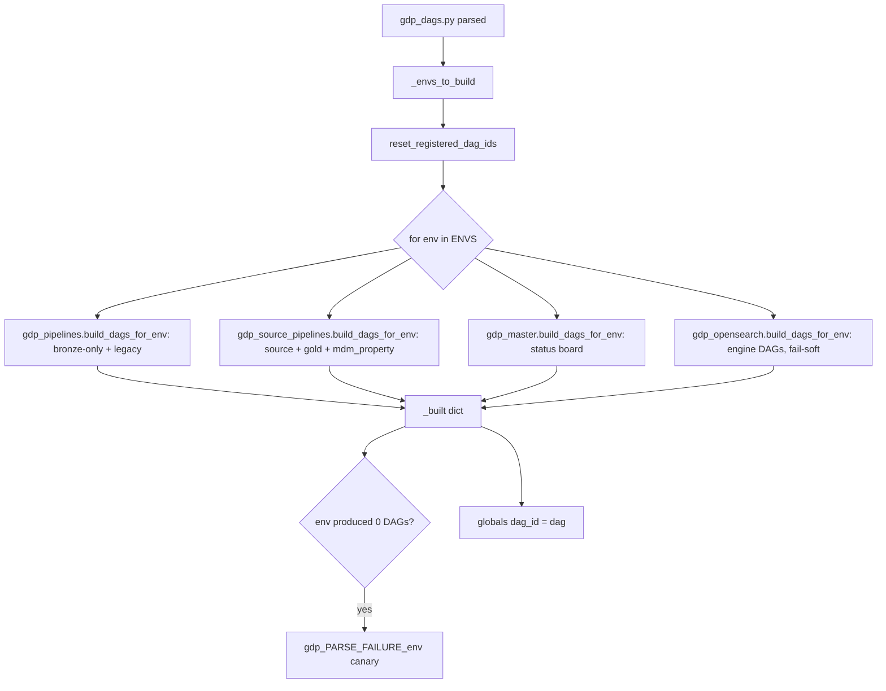
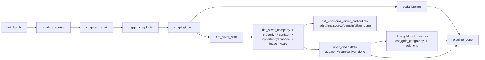
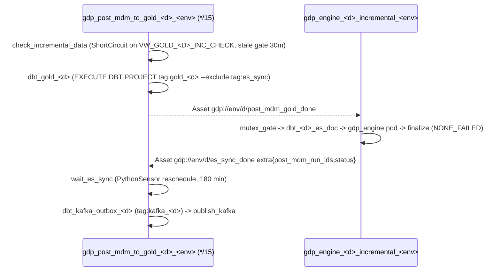

# GDP Airflow DAGs — Knowledge Base

Code root: `gdp-airflow-dags/dags/gdp-dags/` (git root is `gdp-airflow-dags/`).
Runtime: Airflow 3.x on AWS MWAA (Task SDK; no ORM access in tasks/callbacks), Snowflake, SnapLogic, Soda, dbt, Rafay Kubernetes (OpenSearch engine), Confluent Kafka REST, Akeyless secrets, SMTP/SES email.

> Line numbers drift. Always locate code by **function name** (grep `^def <name>`), not by line.

---

## 1. Module map

| Module | Role | Registers DAGs? |
|---|---|---|
| `gdp_dags.py` | **Single DAG entrypoint.** Resolves env list, calls every builder, registers results in `globals()`, canary DAGs | Yes |
| `gdp_post_mdm.py` | Self-contained post-MDM gold + Kafka DAGs (does NOT import `gdp_utils`) | Yes |
| `gdp_dataset_reset.py` | Admin DAG `admin_reset_dataset_dependencies` (clear queued Asset events) | Yes |
| `gdp_utils.py` (~9k lines) | Core library: env, Snowflake, Akeyless, batch master, task factories, `build_source_dag`, `build_gold_dag`, `build_bronze_only_dag`, `build_mdm_property_trigger_dag`, callbacks | No (`.airflowignore`) |
| `gdp_pipelines.py` | `DOMAIN_CONFIGS` registry per env + bronze-only / legacy DAG builder | No |
| `gdp_source_pipelines.py` | Builds source DAGs, gold DAG, MDM property coordinator; DNB gate; isolated sources | No |
| `gdp_master.py` | `gdp_master_<env>` status-board DAG (ExternalTaskSensors) | No |
| `gdp_opensearch.py` | `gdp_engine_<domain>_<mode>_<env>` DAGs, `GdpEnginePodOperator`, Snowflake mutex | No |
| `gdp_dbt.py` | `dbt_run_task` (dbt-ol subprocess, git-repo cache, transient retry, model logging) | No |
| `gdp_soda.py` | Soda contract verify / consolidated scan tasks, digest emails, Datadog events | No |
| `gdp_snaplogic.py` | SnapLogic trigger + recursive status polling (`build_snaplogic_trigger_task`) | No |
| `gdp_notify.py` | Failure/recovery emails, threading, dedupe (no `gdp_utils` import) | No |
| `gdp_alerts.py` | Alert hub: re-exports + SnapLogic summary email, success/cycle emails, branded HTML shell | No |

`.airflowignore` lists every library module so the DAG processor only parses `gdp_dags.py`, `gdp_post_mdm.py`, `gdp_dataset_reset.py`. Library modules are still importable via `sys.path`.

**Rule:** a new library module must (a) register nothing on import and (b) be added to `.airflowignore`. A new DAG family is wired as a `build_dags_for_env(env) -> {dag_id: DAG}` function called from `gdp_dags.py`.

---

## 2. How DAGs are built (parse-time flow)

### 2.1 Env resolution (`_envs_to_build` in `gdp_dags.py`)
Priority:
1. Literal `/dev/`, `/qa/`, `/uat/`, `/prod/` segment in the file path (per-env S3 folder).
2. `GDP_ENVS` (comma list).
3. `GDP_ENV` (single).
4. `gdp_utils._resolve_env()` auto-detect (`AIRFLOW_ENV_NAME`, webserver base URL, remote log folder, file path; word-boundary match; **prod-guard** raises if "prod" seen but not strictly matched).
5. Default `dev,qa,uat` (never prod by default).

If the instance looks like prod but `prod` is not in the build list → `gdp_ENV_MISMATCH` canary DAG.

### 2.2 Per-env global switching
`gdp_utils._set_env(env)` mutates module globals (`GDP_ENV`, `UTIL_DB`, `BRONZE_DB`, `SILVER_DB`, `BATCH_MASTER_FQN`, `SNAPLOGIC_MASTER_FQN`, `DBT_PROJECT_FQN`, Akeyless paths) and clears env-dependent caches. Called:
- at parse time before building each env;
- at task runtime via `_set_env_from_context(context)` which reads the DAG tag `env=<env>`.

**Every DAG must carry the tag `env=<env>`** — tasks use it to target the right env.

### 2.3 Failure semantics at parse time (important design rule)
- Config reads (Snowflake/Akeyless) **raise** → `gdp_dags.py` re-raises → Airflow records Import Error and **keeps last-good DAGs** (no flicker / disappearing DAGs).
- A single bad source inside the loop is caught and logged; siblings continue.
- Gold DAG and MDM coordinator builds are fail-closed (raise).
- `reset_registered_dag_ids()` runs **outside** the try so a failed parse can't leave stale "already registered" ids.
- Env with genuinely 0 DAGs (empty config) → `gdp_PARSE_FAILURE_<env>` canary.
- OpenSearch builder is fail-soft (returns `{}`).

### 2.4 DAG ID catalogue (all env-suffixed)

| DAG ID | Builder | Trigger |
|---|---|---|
| `gdp_<source>_<env>` | `gdp_utils.build_source_dag` | Cron (`_no_catchup`), Dataset gate (DNB_API), or `None` (manual/isolated) |
| `gdp_<source>_bronze_only_<env>` | `gdp_utils.build_bronze_only_dag` | Cron / manual |
| `gdp_gold_<env>` | `gdp_utils.build_gold_dag` | Dataset AND of gold-feeding sources' `silver_done` |
| `gdp_mdm_property_<env>` | `gdp_utils.build_mdm_property_trigger_dag` | Dataset AND of property `silver_done` of gating sources |
| `gdp_master_<env>` | `gdp_master.build_dags_for_env` | `GDP_MASTER_SCHEDULE` (default manual) |
| `gdp_engine_<domain>_incremental_<env>` | `gdp_opensearch` | Asset `post_mdm_gold_done` |
| `gdp_engine_<domain>_bulk_<env>` | `gdp_opensearch` | `GDP_ENGINE_BULK_CRON` or manual |
| `gdp_engine_<domain>_reindex_<env>` | `gdp_opensearch` | Manual, paused on creation |
| `gdp_post_mdm_to_gold_<domain>_<env>` | `gdp_post_mdm` (module level loop) | Cron `*/15 * * * *` |
| `admin_reset_dataset_dependencies` | `gdp_dataset_reset` | Manual |
| `gdp_PARSE_FAILURE_<env>`, `gdp_ENV_MISMATCH` | `gdp_dags._build_parse_failure_canary` | Canary only |

Domains for engine/post-MDM: `property`, `company`.

---

## 3. Configuration sources

### 3.1 Snowflake config tables (`<ENV>_GDP_UTIL_DB.CONFIG`)
| Table | Purpose |
|---|---|
| `GDP_SNAPLOGIC_CONFIG_MASTER` | **Source registry**: SOURCE_SYSTEM, DOMAIN, SCHEDULE_CRON, SCHEDULE_FREQUENCY, AIRFLOW_SOURCE_SYSTEM, ACTIVE_FLAG. Drives which source DAGs exist and their domains (`_get_source_domain_map()` → `{SOURCE: [domains]}`) |
| `GDP_BATCH_MASTER` | Write-only audit per run/stage: ORCHESTRATION_ID, BATCH_ID, SNAPLOGIC_*, DBT_*, SODA_*, DBT_GOLD_* status/dates, SNAPLOGIC_RUID |
| `GDP_DAG_DEPENDENCY` | Cross-DAG activation flags |
| `GDP_DAG_MUTEX` | OpenSearch per-domain advisory lock rows |
| `GDP_DBT_<ENV>` | Snowflake DBT PROJECT object |

DB naming: `<ENV>_GDP_UTIL_DB`, `<ENV>_GDP_BRONZE_DB` (schemas `BRONZE_<SOURCE>`), `<ENV>_GDP_SILVER_DB` (schema per domain), `<ENV>_GDP_GOLD_<DOMAIN>_DB`. Role `<ENV>_GDP_DATA_ENGINEER_ROLE`, warehouse `<ENV>_GDP_DATA_ENGINEER_WHS`.

### 3.2 `DOMAIN_CONFIGS` (`gdp_pipelines.py`)
`_BASE_DOMAIN_CONFIGS` is deep-copied into `DOMAIN_CONFIGS_BY_ENV[env]`; read via `get_domain_configs(env)`. Edit one env's list to diverge it.

Keys per entry:
- `domain` (required), `dbt_command` (default `run`), `use_datasets` (must be True for source/gold topology)
- `soda_datasets` — silver tables to scan
- `silver_select` — source-agnostic silver selector (e.g. geography `tag:geography_silver`)
- `gold_select` — gold selector (e.g. `tag:gold_opportunity`); absent ⇒ silver-only domain
- `soda_bronze_datasets_by_source` — `{SOURCE: {"schema": ..., "datasets": [...]}}`
- `soda_datasets_by_source` — supplemental silver scans per source
- `mdm_trigger_by_source` — Reltio MDM DAG ids with `{env}` placeholder

Domains: company, property (silver-only, MDM-fed), contact, opportunity, finance, lease, sale (gold), geography (inline gold in ATLAS source DAG).

### 3.3 Knobs
`gdp_utils._cfg_get(name, default)`: **env var first**, then Airflow Variable (avoids secrets-backend noise at parse time). `airflow_variable()` bridges Airflow 2/3 `Variable.get` signatures and never raises.

Key env vars / Variables:
- Env: `GDP_ENV`, `GDP_ENVS`
- Scheduling: `GDP_SOURCE_DAG_SCHEDULE_ENABLED`, `GDP_MANUAL_ONLY_SOURCES` (default includes LIGHTBOX, PDL, ATLAS, INTROHIVE, DIGITAL_MARKETING, DNB_FILE), `GDP_DNB_SOURCES`, `GDP_DNB_GATE_EXCLUDE`, `GDP_MDM_PROPERTY_GATE_*`, `GDP_MAX_RUN_AGE_SEC`, `GDP_SCHEDULE_GRACE_SEC`, `GDP_SUPPRESS_UNPAUSE_RUN`
- dbt: `GDP_DBT_OL_BIN`, `GDP_DBT_PROJECT_DIR`, `GDP_DBT_RUN_TIMEOUT_SEC` (6h), `GDP_DBT_TRANSIENT_RETRIES`, `GDP_DBT_GIT_*`, `GDP_DBT_CACHE_*`
- Soda: `GDP_SODA_TIMEOUT_SEC` (600), `GDP_SODA_RUNNER_FLAG`, `GDP_SODA_EMAIL_MODE` (`off`|`failed_only`|`all`)
- SnapLogic: `GDP_SNAPLOGIC_TASK_TIMEOUT_HOURS` (24), `GDP_SNAPLOGIC_POLL_INTERVAL_SEC`, `GDP_SNAPLOGIC_INFLIGHT_MODE` (`resume`), `GDP_SNAPLOGIC_MAX_ERROR_COUNT`, `GDP_SNAPLOGIC_EMAIL_MODE`
- Master: `GDP_MASTER_SCHEDULE`, `GDP_MASTER_POKE_SEC`, `GDP_MASTER_TIMEOUT_SEC`, `GDP_MASTER_INCLUDE_BRONZE_ONLY`, `GDP_MASTER_REQUIRE_ALL_SUCCESS`
- Post-MDM: `GDP_POST_MDM_ES_SYNC_ENVS` (default `dev,qa,uat,prod`), `GDP_POST_MDM_ES_SYNC_WAIT_MIN` (180), `GDP_POST_MDM_PUBLISH_MAX` (20000), `GDP_POST_MDM_BATCH_SIZE` (10000), `GDP_POST_MDM_STALE_RUN_MAX_MIN` (30), `GDP_KAFKA_MAX_RETRIES`
- Engine: `GDP_ENGINE_VERSION` (required, `:latest` refused), `GDP_ENGINE_REGISTRY`, `GDP_ENGINE_DAGS_ENABLED`, `GDP_ENGINE_ENABLED_ENVS`, `GDP_ENGINE_DOMAINS`, `GDP_ENGINE_BULK_CRON`, `GDP_ENGINE_MUTEX_TTL_SEC` (8h), `GDP_ENGINE_DBT_SELECT*`
- Alerts: `GDP_ALERT_EMAILS`, `GDP_SUCCESS_ALERTS_ENABLED`

### 3.4 Secrets (Akeyless)
Path: `/{teams-nonprod|teams}/global-data-platform-gdp/<env>/airflow/<leaf>` with leaves `snowflake-secrets`, `soda-secrets`, `snaplogic`, `snaplogic-polling` (UAT polling reuses QA), `kafka-secrets`. Auth = AWS IAM cloud-id; access id per env (`GDP_AKEYLESS_ACCESS_ID` override). Token cached ~50 min per access id (thread-safe). Snowflake uses key-pair auth (`_get_sf_connection`, keep-alive, 2h network/statement timeout); `_sf_run` uses cached connections — **only retry idempotent reads, never DML**.

---

## 4. Source DAG (`gdp_<source>_<env>`) — `build_source_dag`

- `init_batch` (`init_batch_task`): inserts `GDP_BATCH_MASTER` row, pushes `batch_id`/`orchestration_id` XCom, **skips stale scheduled runs** (`skip_if_stale_run`, `GDP_MAX_RUN_AGE_SEC`).
- `validate_source`: source must be ACTIVE in `GDP_SNAPLOGIC_CONFIG_MASTER`.
- `snaplogic_start` / `snaplogic_end` / `dbt_silver_start`: `update_stage_task(stage, status)` markers; `snaplogic_end` also sends SnapLogic summary email and is the hard stop on failure.
- `trigger_snaplogic`: `gdp_snaplogic.build_snaplogic_trigger_task` — `retries=0` (side-effecting), timeout 24h + 15 min buffer.
- `soda_bronze`: one consolidated scan of `BRONZE_<SOURCE>` curated tables, `ALL_DONE`, warn-and-continue.
- Silver dbt chain in strict FK order: company → property → contact → [opportunity, finance] → lease → sale; only domains the source feeds get tasks; `ALL_SUCCESS`.
- Signal domains (`_SILVER_SIGNAL_DOMAINS`: company, property) get per-domain marker tasks emitting `gdp://<env>/<source>/<domain>/silver_done`.
- `pipeline_done` (`pipeline_done_task`, `ALL_DONE`): final status to batch master + notification. **The master DAG sensors watch this task id** — never rename it.

Scheduling rules (`gdp_source_pipelines.build_dags_for_env`):
- Isolated sources (`_ISOLATED_SOURCES`, e.g. DNB_FILE): `schedule=None`, `isolated=True` → no outlets, no silver markers, no MDM trigger, never gate gold.
- DNB targets (`_DNB_TARGET_SOURCES`, DNB_API): Dataset-gated on every other company source's `company/silver_done` (`_dnb_gate_schedule`, excludes `GDP_DNB_GATE_EXCLUDE`).
- Manual-only (`_MANUAL_ONLY_SOURCES`): `schedule=None`.
- On-demand (`_ON_DEMAND_SOURCES`): built paused.
- Otherwise `_resolve_source_schedule(src)` (cron + frequency) wrapped by `_no_catchup` (CronTriggerTimetable, no catch-up; `_no_catchup_start_date` suppresses missed ticks).
- Gold gate only includes sources feeding a `gold_select` domain that is not inline-gold (so quarterly LIGHTBOX / monthly ATLAS don't starve daily gold).

## 5. Gold DAG (`gdp_gold_<env>`) — `build_gold_dag`
Schedule = list of `_source_silver_done_dataset(src, env)` (Dataset AND). Only built sources are listed (a Dataset with no producer would hang it forever).

`init_batch → soda_silver (consolidated, once for platform) → soda_post_mdm (COMPANY_MDM/PROPERTY_MDM) → gold_start → dbt_gold_<domain> (parallel: opportunity, finance, contact, lease, sale, supplemental) → gold_end → soda_gold → notify_* (optional, gdp_alerts) → pipeline_done`.
Batch row uses sentinel `source_system="gold"`, `domain="all_domains"`. Gold-DAG Soda never decides pass/fail.

## 6. MDM property coordinator (`gdp_mdm_property_<env>`)
Waits on `property/silver_done` of every gating source (default excludes LIGHTBOX, isolated, unbuilt) and fires the single Reltio MDM property DAG via `TriggerDagRunOperator`. Replaced four legacy per-source `trigger_mdm_property` tasks. Not registered if gate resolves empty.

## 7. Master status board (`gdp_master_<env>`)
Observes, never launches. `begin → status_gdp_<src>` (TaskGroup) / `status_gdp_<src>_bronze_only`; company sources → `status_gdp_dnb_api`; all sources → `status_gdp_gold` → `all_pipelines_complete` (`ALL_DONE`, or `ALL_SUCCESS` if `GDP_MASTER_REQUIRE_ALL_SUCCESS=1`).
Sensors: `ExternalTaskSensor(external_task_id="pipeline_done", execution_date_fn=_latest_logical_date_fn(dag_id), mode="reschedule", check_existence=True, failed_states=[failed, upstream_failed, skipped])` — watches each DAG's **latest** run (cron-independent). Layout via `_resolve_layout(env)`; fails hard.

## 8. Post-MDM → OpenSearch → Kafka (Asset chain)

### 8.1 `gdp_post_mdm.py` (self-contained)
- Module-level loop over `DOMAIN_CONFIG` (company, property): `inc_check_view`, `gold_table`, `dbt_select`, `kafka_dbt_select`, `kafka_outbox_table` (`<UTIL_DB>.AUDIT.KAFKA_OUTBOX_<D>`), `kafka_bulk_view`.
- `max_active_runs=1`, `catchup=False`, DAG-level `notify_dag_failure`; task-level `notify_failure` on dbt gold; `notify_recovery` on `publish_kafka` success.
- `wait_es_sync` only if `ENV in ES_SYNC_ENVS`; extra.status `failed` → fail, `skipped` → skip. Kafka tasks are `ALL_SUCCESS` so Kafka never runs ahead of search; nothing is lost (watermark + outbox).
- `publish_kafka`: claim PENDING (+ ERROR under retry limit) rows; > `PUBLISH_MAX_RECORDS` ⇒ BULK mode (park + alert, succeed); else STREAM in chunks of `BATCH_SIZE` via Confluent REST v3 (`/kafka/v3/clusters/{cluster}/topics/{topic}/records`, Azure AD OAuth, urllib3 Retry on 429/5xx), commit per chunk (crash-safe), audit `KAFKA_PUBLISH_LOG`. Topic: nonprod `{account}-gdp-{env}-{domain}-batch`, prod from secret.
- Timeouts: Snowflake `STATEMENT_TIMEOUT_IN_SECONDS` fires first (6h); Airflow `execution_timeout` = publish timeout + buffer is the backstop.
- Emits OpenLineage START/COMPLETE/FAIL for Datadog; parses dbt node lines from `SYSTEM$GET_DBT_LOG`.

### 8.2 `gdp_opensearch.py`
- Modes `incremental | bulk | reindex`; domains `property | company`; `ENABLED_ENVS`, `ENABLED_DOMAINS`.
- Task graph: `mutex_gate → dbt_<d>_es_doc → gdp_engine_<mode> → finalize`; incremental adds `signal_es_sync_failed` (`ONE_FAILED`) emitting es_sync_done status=failed so post-MDM fails fast.
- Mutex: row in `<UTIL_DB>.CONFIG.GDP_DAG_MUTEX`, lock `<domain>_es_sync`, TTL reaper + `INSERT ... WHERE NOT EXISTS`; loser raises `AirflowSkipException`. `finalize` (`NONE_FAILED`) releases only if this run acquired. Optional secondary pool `GDP_ENGINE_MUTEX_POOL` (must exist or tasks queue forever).
- es-doc dbt: `EXECUTE DBT PROJECT ... --select <domain>_es_doc`; bulk/reindex batched with `--vars {full_load, batch_mod, total_batches}`; pool `gdp_heavy`.
- `GdpEnginePodOperator` (KubernetesPodOperator subclass): image `<registry>/gdp-engine/<env>:<version>` (Jenkins tokens `{CONTAINER_REGISTRY_HOST}`/`{RECENT_PUSHED_VERSION}`, per-env fallbacks), cmd `python main.py run --pipeline sync_<d>_es --mode <mode>`, namespace `gdp-nonprod-<env>` / `gdp-prod-ns`, kubeconfig materialized from Akeyless to a temp file, non-root (uid/gid 1000), node selector `memorymax`, sizing **only** via `ENGINE_POD[domain][mode]` constants (namespace quota: req 40 CPU/80Gi, lim 80 CPU/320Gi, 20 pods). `cleanup` reads base-container logs, parses engine JSON lines → XCom `engine_failure_details` → failure email.
- Engine exit codes: 0 ok, 1 systemic (no progress kept), 2 partial (progress kept), 130 interrupted.

---

## 9. Building blocks (task factories)

### dbt — `gdp_dbt.dbt_run_task(model=None, task_id=None, dbt_command="run", pool=None, domain=None, models=None, entity_ids=False, model_batches=None, silver_selector=False, is_gold=False, silver_select=None)`
1. Resolve batches (model_batches → models → model).
2. Silver selector `tag:<src_alias>_<domain>_silver tag:<domain>_merged_pipeline` or `silver_select`.
3. Fetch dbt project from Snowflake GIT REPOSITORY into a per-(branch, sha) cache (`/tmp/.gdp_dbt_project_cache`, file lock, atomic rename, `dir` GET mode to avoid rate limit 093563, prune with grace > longest run). Partial-parse msgpack reused.
4. Materialize key-pair PEM, patch `profiles.yml`.
5. Run `dbt-ol run --select execute_via_snowflake` (wrapper model → `EXECUTE DBT PROJECT` server-side); extra vars via `dbt_vars` → `model_vars`.
6. Transient errors (e.g. "Operations rate limit exceeded") retried in place with linear backoff (`GDP_DBT_TRANSIENT_RETRIES`, 45s base). Wall-clock deadline on reader thread.
7. Per-model results logged from `SYSTEM$GET_DBT_LOG(job_id)`; OpenLineage to Datadog.
Pools: `_dbt_pool_for_domain()` → `gdp_heavy` for all dbt; `_gdp_pool()` for Soda.

### Soda — `gdp_soda`
- `soda contract verify --dataset <ds> --use-runner --soda-cloud <cfg> --publish` subprocess (`start_new_session=True`, timeout 600s), Soda Cloud creds from Akeyless (redacted logging).
- Outcome via `_classify_soda_outcome` → PASSED/FAILED/SKIPPED/ERROR; bronze FAILED downgraded to WARN.
- **Warn-and-continue**: Soda tasks never fail the DAG.
- Consolidated tasks: `soda_consolidated_scan_task` (bronze per source), `soda_silver_consolidated_scan_task`, `soda_post_mdm_scan_task`, `soda_gold_all_scan_task`. Curated allow-lists only (`BRONZE_/SILVER_/GOLD_/MDM_SODA_DATASETS` in `gdp_utils`), env-aware Soda data-source prefixes (`_SODA_DATA_SOURCE_BY_ENV`).
- Digest email inline (`_send_soda_scan_digest`) gated by `GDP_SODA_EMAIL_MODE` (default off). Structured Datadog JSON event per dataset.

### SnapLogic — `gdp_snaplogic._trigger_and_wait`
- Secrets: `snaplogic` (url, trigger_path, bearer_token) and `snaplogic-polling` (status_url, status_token).
- Trigger POST with query params SOURCE_SYSTEM, DOMAIN, BATCH_ID, airflow_dag_name, airflow_dag_run_id; retry **only** on 429/safe connect errors (never on timeout/5xx — may have triggered).
- **Idempotency:** in-flight RUID in batch master with SNAPLOGIC_STATUS=RUNNING is resumed (`GDP_SNAPLOGIC_INFLIGHT_MODE=resume`) instead of re-triggering after worker loss.
- Poll until terminal; success requires 2 consecutive `completed` observations; children polled recursively under a shared deadline; failure states include failed/stopped/aborted/cancelled/skipped (override `GDP_SNAPLOGIC_TREAT_SKIPPED_AS_SUCCESS`); `error_count > GDP_SNAPLOGIC_MAX_ERROR_COUNT` fails.
- Readable failure report (`_log_snaplogic_failure_report`), secrets redacted in response dumps.

### Batch master / stage tasks (`gdp_utils`)
`init_batch_task`, `validate_source_task`, `update_stage_task(stage, status)`, `pipeline_done_task`, `reconcile_batch_status_task`. Batch master is **write-only audit** — never read back to drive control flow (except SnapLogic in-flight resume).

### Defaults
`START_DATE = pendulum.datetime(2024,1,1, tz="America/Chicago")`; `DEFAULT_ARGS`: owner `gdp-team`, `retries=0`, `execution_timeout=2h`, `post_execute=_post_task_sleep` (5s CloudWatch log flush). `max_active_runs=1` typical.

---

## 10. Alerting

- **Task-level callbacks send failure emails** (`pipeline_failure_callback`, `gdp_notify.notify_failure`). On Airflow 3 the DAG-level `on_failure_callback` runs in the DAG processor; its `ti` is NOT the failed task and SDK DagRun lacks `get_task_instances`. `notify_dag_failure` uses `ti.get_task_states` and dedupes via XCom `failure_alert_sent`.
- Recipients: Variable `GDP_ALERT_EMAILS` → env `GDP_ALERT_EMAILS` → `AIRFLOW_VAR_GDP_ALERT_EMAILS` → last-good → default. `parse_email_list` accepts comma/semicolon/JSON/`Name <addr>`.
- Threading: one open thread per DAG in Variable `gdp_alert_thread__<dag_id>`; replies `RE: <subject>` with Thread-Topic/Thread-Index (MS-OXOMSG); Message-IDs unique per email (SES rewrites; Exchange drops duplicates). Recovery (`notify_recovery`, `pipeline_done`) replies "RESOLVED" and closes thread.
- Dedupe keys `dag::run::task::try`; intermediate retries skipped; stale-skipped runs suppressed.
- `gdp_alerts`: SnapLogic summary email (`GDP_SNAPLOGIC_EMAIL_MODE`), success/cycle emails (`GDP_SUCCESS_ALERTS_ENABLED`, `GDP_CYCLE_LOOKBACK_HOURS`), branded HTML shell, `gdp_subject(env, headline)`.
- Alerts must never raise into tasks (wrap in try/except).

---

## 11. Recipes

### Add a new source
1. Insert ACTIVE rows (one per domain) in `<ENV>_GDP_UTIL_DB.CONFIG.GDP_SNAPLOGIC_CONFIG_MASTER` with SCHEDULE_CRON + AIRFLOW_SOURCE_SYSTEM.
2. Add bronze Soda tables to `BRONZE_SODA_DATASETS["BRONZE_<SRC>"]` or `soda_bronze_datasets_by_source` in the domain config.
3. If it feeds property/company MDM, add `mdm_trigger_by_source` / check MDM gate exclusions.
4. Manual-only? add to `_MANUAL_ONLY_SOURCES`; isolated? `_ISOLATED_SOURCES`; on-demand? `_ON_DEMAND_SOURCES`.
5. Add to `_FALLBACK_ALLOWED_SOURCES` if needed. Next parse builds `gdp_<src>_<env>`; master/gold gates update automatically.

### Add a new domain
Add entry to `_BASE_DOMAIN_CONFIGS` (domain, `use_datasets=True`, `soda_datasets`, optional `gold_select`), place it in the silver FK order, add `SILVER_/GOLD_SODA_DATASETS`, ensure dbt tags `<alias>_<domain>_silver`, `<domain>_merged_pipeline`, `gold_<domain>` exist.

### Add a new DAG family
Library module with `build_dags_for_env(env) -> dict`, no import-time registration, tag `env=<env>`, add to `.airflowignore`, call it in the env loop in `gdp_dags.py`. Config failures must raise (keep last-good), per-item failures may be swallowed.

### Change engine pod size
Edit `ENGINE_POD[domain][mode]` in `gdp_opensearch.py` only; stay within namespace quota; run `tests/verify_engine_autosize.py`.

### Clear stuck Asset queue
Trigger `admin_reset_dataset_dependencies` with `target_dag_id` (or `clear_all=true`), `dry_run=true` first (uses MWAA `invoke_rest_api`).

---

## 12. Gotchas
- Never rename `pipeline_done` or the `env=<env>` tag.
- Never gate a Dataset schedule on a source whose DAG wasn't built (hangs forever) — builders intersect with `built_sources`.
- SnapLogic trigger and Kafka publish are side-effecting: `retries=0`, idempotency via batch master / outbox status.
- `_sf_run(retries=...)` only for reads.
- Missing Airflow pool ⇒ task queued forever (`gdp_heavy`, `GDP_ENGINE_MUTEX_POOL`).
- `_cfg_get` reads env vars before Variables on purpose (parse-time secrets backend noise).
- DNB_FILE is isolated + manual; DNB_API alone is Dataset-gated.
- Default env list never includes prod; prod needs folder `/prod/`, `GDP_ENVS=prod` or `GDP_ENV=prod`.
- Engine `:latest` image tag is refused.

## 13. Tests (`gdp-airflow-dags/tests/`)
Mostly AST-extract scripts — no Airflow needed: `python tests/verify_<name>.py`.
- `verify_env_resolution.py`, `validate_env_isolation.py` — env detection & isolation
- `verify_cross_module_imports.py` — import coupling
- `verify_dbt_model_logging.py`, `verify_dbt_ol_changes.py`, `verify_dbt_transient_retry.py`, `verify_es_doc_dbt_sql.py` — dbt
- `verify_dnb_source_parity.py` — DNB isolation/gating
- `verify_email_list_parsing.py`, `verify_failure_logs.py`, `verify_engine_failure_email.py` — alerts
- `verify_engine_autosize.py` — pod sizing vs quota
- `verify_es_sync_paused_skip.py` — wait_es_sync when engine paused (4 known pre-existing FAILs)
- `test_email_notification.py` (one known pre-existing failure), `test_soda.py`, `test_snowflake_connection.py`, `test_snaplogic_connection.py` — DAG-style smoke tests run in Airflow
- `preview_gdp_cycle_email.py` — render cycle email HTML

Deps: `env-conf/requirements.txt` (+ `constraints.txt`), providers snowflake, amazon, smtp, http, openlineage, cncf-kubernetes; dbt-ol in a separate venv set up by `env-conf/startup.sh`.
